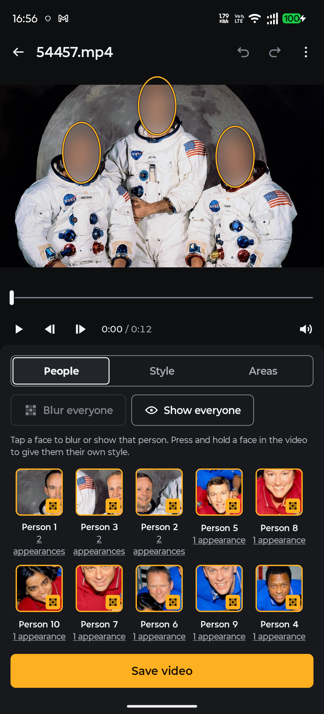
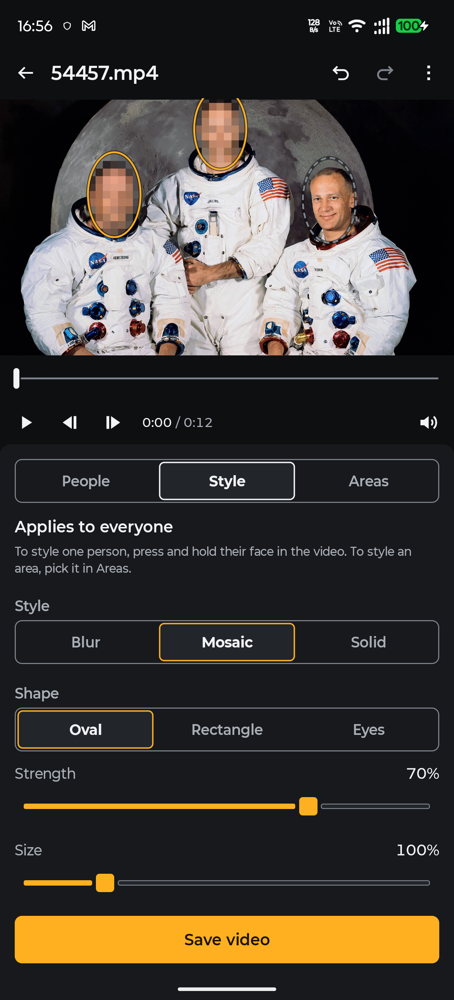
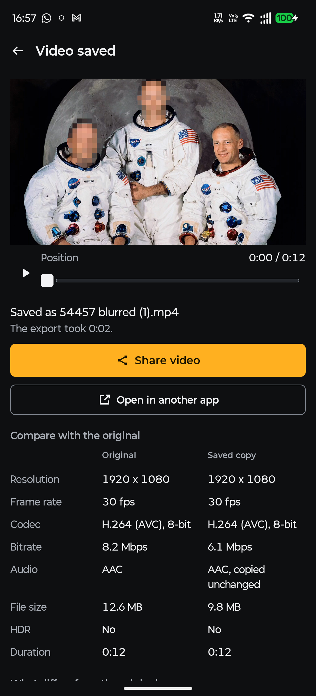

# OpenBlur

OpenBlur blurs the faces you choose in a video, on your Android phone. It finds every face, groups them by person, lets you pick who stays visible, and saves a new copy. The original video is not changed.

The app has no network permission, so it cannot upload your video. You can check this in Android's app info screen under Permissions.

<p>
  
  
  
</p>

## What it does

- Finds faces in every frame and follows each one through the video, including across scene cuts.
- Groups the faces into people, so you choose a person once instead of picking faces frame by frame.
- Blurs everyone by default. Tap a person to leave them visible, or tap a face in the video.
- Blur, mosaic or a solid colour, in an oval, a rectangle or a band across the eyes, with adjustable strength and size. Each person can have their own style.
- Areas you draw yourself, for a face the scan missed, a number plate or a screen. An area can follow motion between points you set.
- Live preview with the same effect that goes into the saved file.
- Saves scans, so you can reopen a video without scanning it again.

## What the saved copy keeps

A blur has to be drawn into every frame, so the video track is encoded again. OpenBlur keeps everything else as close to the original as the phone allows:

- Same resolution, rotation, frame timing and frame count.
- Same codec (H.264 or HEVC) where the phone can encode it. The encoder is asked for a bitrate a little above the original's, and "Higher bitrate" in the save screen roughly doubles that. Hardware encoders often use less than they are asked for on easy footage, so the saved file can be smaller than the original.
- HDR video stays HDR when the phone has an HDR-capable encoder (tested with HLG).
- The audio track is copied unchanged. Formats the MP4 writer cannot copy, such as AC-3, are re-encoded to AAC, and the app tells you before saving.
- Creation time and location are kept. You can remove the location when saving.

After saving, the app reads the new file back and shows it next to the original: resolution, frame rate, codec, bitrate, audio, size and HDR. Anything that differs is listed in plain words.

Some phones post-process decoded video, for example by brightening it. OpenBlur checks the phone's decoder against a small reference clip before the first export, and turns that processing off or uses the exact software decoder, so the copy keeps the original's colours.

Known limits, which the app reports when they apply:

- Only the first audio track is kept.
- Dolby Vision and HDR10+ dynamic metadata are not kept. The video stays HDR.
- 10-bit SDR video is saved as 8-bit.

## How it works

| Step | What runs |
|---|---|
| Face detection | [YuNet](https://github.com/ShiqiYu/libfacedetection.train) (BSD-3-Clause), through ONNX Runtime on the CPU |
| Grouping people | [SFace](https://github.com/opencv/opencv_zoo/tree/main/models/face_recognition_sface) from OpenCV Zoo (Apache-2.0), 8-bit model |
| Tracking | ByteTrack-style matching with a Kalman filter, scene-cut detection, gap filling and smoothing, written for this app |
| Blur | An OpenGL ES shader run by Jetpack Media3 for both the preview and the export |
| Decoding, encoding, MP4 writing | Jetpack Media3 Transformer and the phone's hardware codecs |

The code is split into small modules: `core` and `api` hold the shared types, `vision`, `tracking` and `editing` are plain Kotlin with JVM tests, and `render`, `analysis`, `export`, `designsystem`, `editor` and `shell` are the Android parts.

## Install

Download the APK from [Releases](https://github.com/vikas0706/openblur/releases) and open it on your phone. Android 8.0 or later is required.

## Build from source

You need JDK 17 or later and the Android SDK with platform 37 and build tools 36.

```bash
./gradlew :app:assembleDebug
```

The APK is written to `app/build/outputs/apk/debug/`. For a signed release build, create `keystore.properties` in the project root with `storeFile`, `storePassword`, `keyAlias` and `keyPassword`, then run `./gradlew :app:assembleRelease`.

Tests that run on the computer:

```bash
./gradlew test testDebugUnitTest
```

The device test scans and exports real videos and compares the saved files with the originals frame by frame. It needs the test videos on the phone:

```bash
bash _tools/make_test_videos.sh
adb push _dl/testvideos/. /data/local/tmp/openblur-tests/
./gradlew :app:connectedDebugAndroidTest
```

`make_test_videos.sh` builds the clips with ffmpeg from two public-domain NASA crew photos, which it expects in `_dl/apollo/` and `_dl/sts107/`.

## Licence

OpenBlur is free software under the GNU General Public License, version 3 or any later version. See [LICENSE](LICENSE).

The face models keep their own licences: YuNet under BSD-3-Clause ([models/yunet_n_dynamic.LICENSE.txt](models/yunet_n_dynamic.LICENSE.txt)) and SFace under Apache-2.0 ([models/face_recognition_sface.LICENSE.txt](models/face_recognition_sface.LICENSE.txt)).
